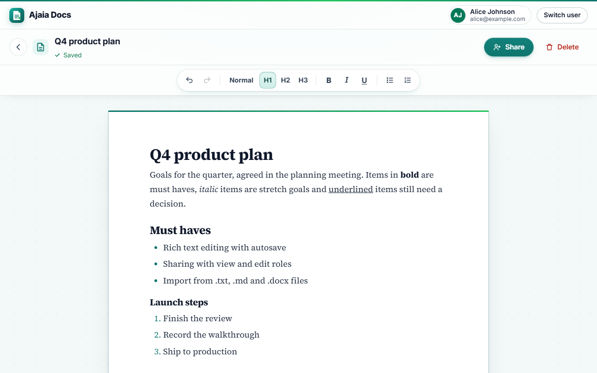

# Ajaia Docs

**Live app: https://ajaia-assessment-bice.vercel.app**

A lightweight collaborative document editor. People create and format documents, import files, share them with view or edit access, and two editors can never silently overwrite each other. Designed, built, tested, deployed on Vercel with a Neon Postgres database, documented and recorded within the 4 hour timebox.

**Stack:** React 19 and TipTap 3 on Vite for the frontend; JavaScript (Node.js) serverless functions on Vercel for the backend; Postgres on Neon in production, with PGlite (Postgres in WebAssembly) for local runs and tests.

| | |
|---|---|
| Live app | https://ajaia-assessment-bice.vercel.app |
| Source | https://github.com/shishir-codes/ajaia-assessment |
| Architecture note | [docs/ARCHITECTURE.md](docs/ARCHITECTURE.md) |
| AI workflow note | [docs/AI_WORKFLOW.md](docs/AI_WORKFLOW.md) |
| What is included | [SUBMISSION.md](SUBMISSION.md) |
| Walkthrough video | [VIDEO_URL.txt](VIDEO_URL.txt) |



## Try it in 2 minutes

Pick a seeded account on the first screen. There are no passwords, and the server still enforces every permission.

| Account | Starts with |
|---|---|
| alice@example.com (Alice Johnson) | Owns "Welcome to Ajaia Docs" (shared with Bob as editor) and can view Bob's "Team meeting notes" |
| bob@example.com (Bob Smith) | Owns "Team meeting notes" (shared with Alice as viewer) and can edit Alice's welcome document |
| carol@example.com (Carol Lee) | Nothing yet: use her to confirm that unshared documents stay private |

1. **Sign in as Alice.** Home shows "My documents" and "Shared with me", each row with a role badge.
2. **New document.** Replace "Untitled document" at the top with your own title and press Enter, then write and format with the toolbar. The status moves from "Unsaved changes" to "Saving..." to "Saved". Reload the page: everything is still there.
3. **Import file.** Choose a .txt, .md or .docx file of up to 2 MB. It opens as a new, editable document.
4. **Share.** Add bob@example.com with "Can view", then press "Switch user" and sign in as Bob. The document is under "Shared with me", read only, with no toolbar.
5. **Conflict.** Open one document in two tabs. Edit in the first tab, then in the second. The second save is stopped before it overwrites anything, and the banner offers "Load latest" or "Keep mine".
6. **Privacy.** Sign in as Carol. She sees none of these documents, and a direct link shows "Document not found".

## What works end to end

| Area | What works |
|---|---|
| Sign in | Pick a seeded user. The server issues a signed, HttpOnly session cookie. "Switch user" signs out. |
| Documents | Create, rename (Enter or leaving the field saves, Escape reverts), delete with a confirmation (owner only). |
| Rich text | Bold, italic, underline, Heading 1 to 3, normal text, bulleted and numbered lists, undo and redo, keyboard shortcuts such as Ctrl+B. |
| Saving | Autosave about 1 second after typing stops, Ctrl+S, and a visible save state. Network failures retry with backoff and offer "Retry now". A refresh reopens the saved document. |
| Import | .txt, .md, .markdown and .docx files up to 2 MB become a new editable document titled from the file name. Formatting is kept; scripts and unsafe links are removed. |
| Sharing | Share by email as a viewer or an editor. The owner changes roles and removes access. Home separates "My documents" from "Shared with me". |
| Permissions | Owner, editor and viewer rules are enforced on the server for every request. No access answers 404, so a document's existence is never revealed. |
| Concurrency | A stale save gets 409 and the editor offers "Load latest" or "Keep mine". 20 simultaneous saves from one version produce exactly one success. |
| Access changes mid edit | If the owner removes access or downgrades an editor while they type, the editor locks, explains why and keeps their text on screen to copy. |
| Layout and access | Responsive at desktop and phone widths (checked at 1280 px desktop, 768 px tablet and 390 px phone widths). Labelled controls, visible focus, keyboard friendly dialogs. |

## Supported imports

| File | How it is converted |
|---|---|
| .txt | Each line becomes a paragraph. Text is escaped, so markup shows as plain text. UTF-8 (with or without a byte order mark) or UTF-16 with a byte order mark. |
| .md, .markdown | Headings, bold, italic, lists and links through marked, then sanitised. |
| .docx | Paragraphs, Word heading styles, bold, italic and underline through mammoth, then sanitised. Images are skipped. |

The 2 MB limit is checked in the browser first and again on the server. Other types get a clear message (415), empty or unreadable files get 422, and oversized files get 413.

## How I work

- **Guardrails before speed.** I build with AI under a standing rules file (CLAUDE.md) that Claude Code loads every session. The agent surfaces risk before acting and stops for my explicit go ahead on anything that touches production servers, DNS, secrets, deploys, spending or credentials.
- **Plans name their risks.** Every plan states what changes, the blast radius, the edge cases (empty, malformed, oversized, unicode, concurrent, partial failure, retry, permission denied, upstream failure, second run), how we would know it broke, and how to roll back.
- **Verification by risk.** Highest risk first: availability, anything that writes, anything that spends, security, then surfaces. Nothing is called verified unless it was actually run, and failures are reported with their real output.
- **A human makes the calls.** I set the goal and the timebox, approved the scope and the stack, and made the product and risk decisions listed in [docs/AI_WORKFLOW.md](docs/AI_WORKFLOW.md).
- **Secrets stay out of code.** Database credentials stay out of the repo and the submission folder; production reads them from Vercel environment variables. A scan of the repo for connection strings and keys finds nothing.

## Run it locally

Needs Node.js 22.12 or newer (checked with Node 24).

```bash
git clone https://github.com/shishir-codes/ajaia-assessment.git
cd ajaia-assessment
npm ci
npm run dev
```

Open http://localhost:5200. `npm run dev` starts Vite on port 5200 and the local API on 127.0.0.1:5288, and Vite proxies `/api` to it.

No database setup is needed. Without `DATABASE_URL`, the API uses PGlite (full Postgres compiled to WebAssembly) stored in `.data/pglite`, which is git ignored. The schema and the demo data are created on first use. To use a Neon Postgres database instead, copy `.env.example` to `.env.local` and set `DATABASE_URL` to its connection string.

| Command | What it does |
|---|---|
| `npm run dev` | Web app on 5200 and API on 5288 together |
| `npm test` | 52 tests on an in memory database |
| `npm run build` | Production build into `dist/` |
| `npm run smoke -- <url>` | 39 live HTTP checks against a running copy, local or deployed |
| `node scripts/reset-demo.mjs` | Restores the two demo documents and their shares (maintainer only) |

## Tests and verification

`npm test` runs 52 tests in 19 suites with Node's built in test runner against PGlite in memory: no network, no keys, about 15 to 30 seconds.

- **Access matrix:** owner, editor, viewer and a stranger, for read, edit, share and delete.
- **Sessions:** 401 on every protected call, forged and tampered cookies rejected and cleared, 405 with an Allow header.
- **Concurrency:** a stale save gets 409 with the latest document; simultaneous saves from one version, exactly one wins.
- **Import:** .txt, .md, .markdown and a real .docx built inside the test; 415, 413 and 422 for wrong, oversized, empty, binary and broken files; a .docx "zip bomb" and Markdown built to stall the parser are refused before parsing.
- **Sanitising:** scripts, event handlers, styles, iframes, SVG, `javascript:` and `data:` links removed; formatting kept.
- **Validation:** 200 character titles, 500,000 character content, JSON only bodies, unicode, NUL characters in text, ids and emails, and a second run of schema setup and seeding.
- **Safeguards:** the document cap, the creation rate (create and import counted together), the save, share and sign in rate limits with Retry-After, the security headers, and the demo restore run twice.

Beyond the automated suite:

| Check | Result |
|---|---|
| Live browser check on the production URL in headless Microsoft Edge, at desktop 1280 and phone 390 px: sign in, formatting, autosave, reload, rename, three imports, file errors, sharing, view only and editor access, a two browser conflict, privacy and delete | 31 of 31 pass |
| `scripts/smoke.mjs`: real HTTP with real cookies as Alice, Bob and Carol | 39 of 39 pass |
| Adversarial HTTP checks: 5 MB bodies, 20 simultaneous saves, junk cookies, SQL looking ids, Hebrew, emoji and CJK text | 13 of 13 pass |
| Adversarial review of file import | A .docx "zip bomb" and Markdown built to stall the parser are refused before parsing, each pinned by a test |
| Scripted browser QA in headless Microsoft Edge on a fresh database, including two browser conflicts and access loss mid edit | 50 of 50 pass |
| Desktop 1280, tablet 768 (with reduced motion) and phone 390 px | No horizontal scrolling; the toolbar wraps and Share and Delete become icon buttons; 32 of 32 visual flows pass |
| Restart on a file database | Documents and sessions survive; deleted demo documents stay deleted |

## Deployment

- **Vercel:** Vite builds the React app into `dist/`, and each `api/*.js` file becomes a Node.js serverless function. `vercel.json` sets the single page app rewrite, a 30 second function limit and the security headers.
- **Neon Postgres:** connected to the Vercel project through `DATABASE_URL`. The schema is created on the first request.
- **Deploy:** `vercel deploy --prod`. Afterwards `https://ajaia-assessment-bice.vercel.app/api/health` must report `"db":"neon"`, then run `npm run smoke -- https://ajaia-assessment-bice.vercel.app` (it creates and deletes its own documents).

| Variable | Where | Purpose |
|---|---|---|
| `DATABASE_URL` (or `POSTGRES_URL`) | Vercel, Production | Neon connection string. Left empty locally, PGlite is used |
| `SESSION_SECRET` | Vercel, Production | Signs the session cookie |
| `PGLITE_DIR` | Local only | PGlite folder (default `.data/pglite`; tests use `memory://`) |
| `DEV_API_PORT` | Local only | Port of the local API (default 5288) |
| `DEMO_MAX_DOCS`, `DEMO_CREATE_PER_10_MIN`, `DEMO_SAVES_PER_MIN`, `DEMO_SHARES_PER_MIN`, `DEMO_SIGNINS_PER_MIN` | Optional | Override the demo safeguards (tests lower them) |

## API

JSON in and out. Success is `{ "ok": true, ... }`; errors are `{ "ok": false, "error": "Human message", "code": "snake_case" }`.

| Endpoint | Who | What |
|---|---|---|
| `GET /api/health` | Anyone | Liveness and the database in use (`neon` or `pglite`) |
| `GET /api/users` | Anyone | The seeded user directory |
| `GET`, `POST`, `DELETE /api/session` | Anyone | Current user, sign in by email, sign out |
| `GET`, `POST /api/documents` | Signed in | Owned and shared lists; create a document |
| `GET`, `PATCH`, `DELETE /api/document?id=` | By role | Read; save title and content with `baseVersion`; delete (owner) |
| `GET`, `POST`, `DELETE /api/shares` | By role | Who has access; share or change a role (owner); remove access (owner) |
| `POST /api/import` | Signed in | `{ filename, contentBase64 }` becomes a new document |

Status codes: 400 `invalid_input`, 401 `unauthenticated`, 403 `forbidden` or `limit_reached`, 404 `not_found` or `unknown_user`, 405 `method_not_allowed` (with Allow), 409 `version_conflict` (with the latest document), 413 `too_large`, 415 `unsupported_type` or `unsupported_media_type`, 422 `unreadable_file`, 429 `rate_limited` (with Retry-After), 503 `db_not_configured` or `db_unavailable`.

## Project structure

```text
api/                 Vercel serverless functions, one file per route
  _lib/              Shared helpers, not routes: db, session, documents, sanitize,
                     validate, importers, limits, demo, http, errors, log
src/                 React app
  components/        SignIn, Home, EditorPage, Toolbar, ShareDialog, Modal, Header
  lib/               API client, hash router, import checks, formatting, pending saves
tests/               node --test suites (api, import, limits, unit) and shared helpers
scripts/             dev runner, smoke test, demo reset
docs/                Architecture note, AI workflow note, screenshots
dev-api.mjs          Local server for api/*.js, used by npm run dev and the tests
vercel.json          Functions, single page app rewrite, security headers
```

## Public demo safeguards

The live app is public, so reviewers can test freely without breaking anything for the next person. The document cap and the creation rate are counted in the database, inside the insert statement itself, so every server instance shares one count.

| Safeguard | Limit | Response |
|---|---|---|
| Documents per user | 100 owned documents | 403 `limit_reached`: "You have reached the demo limit of 100 documents. Delete one to create another." |
| New documents (create and import together) | 20 per user per 10 minutes, counted in the database | 429 `rate_limited` with Retry-After |
| Saves | 120 per user per minute, per server instance | 429 `rate_limited` with Retry-After |
| Share changes | 30 per user per minute, per server instance | 429 `rate_limited` with Retry-After |
| Sign ins | 20 per IP address per minute, per server instance | 429 `rate_limited` with Retry-After |
| Sizes | Title 200 characters, content 500,000 characters, import 2 MB, request body about 4 MB, plus full input validation | 400 or 413 |
| Demo reset | `node scripts/reset-demo.mjs` puts the two seeded documents and their shares back exactly as seeded and leaves every other document alone (uses `DATABASE_URL` or `POSTGRES_URL`, otherwise PGlite) | Maintainer only, never exposed over HTTP |
| Security headers | `X-Content-Type-Options: nosniff`, `Referrer-Policy: strict-origin-when-cross-origin`, `X-Frame-Options: DENY`, `Permissions-Policy: camera=(), microphone=(), geolocation=()` | Every response |

## Deliberately scoped for this timebox

Real time co editing, comments, real authentication, version history, attachment storage and export were left out on purpose, so the core flows could be finished, hardened and verified. The reasoning and the next 2 to 4 hours of work are in [docs/ARCHITECTURE.md](docs/ARCHITECTURE.md).
